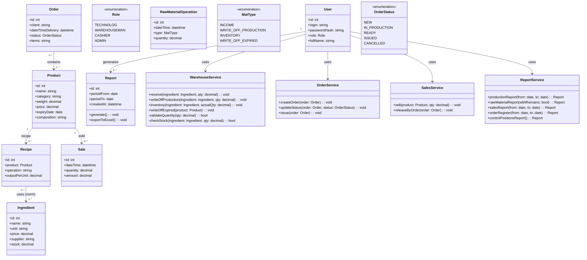
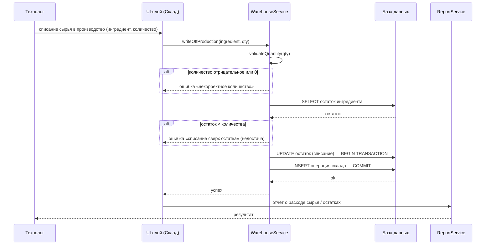
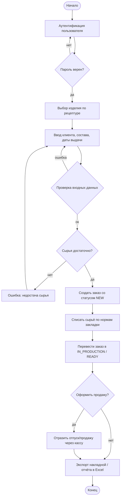
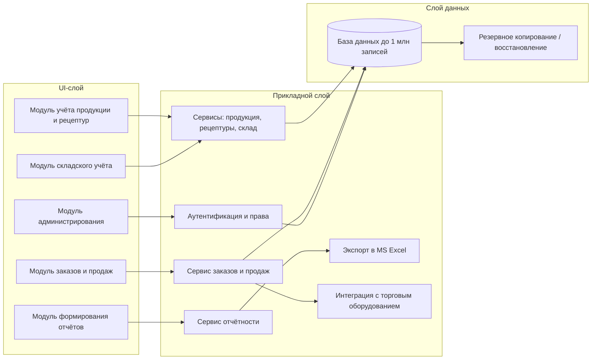
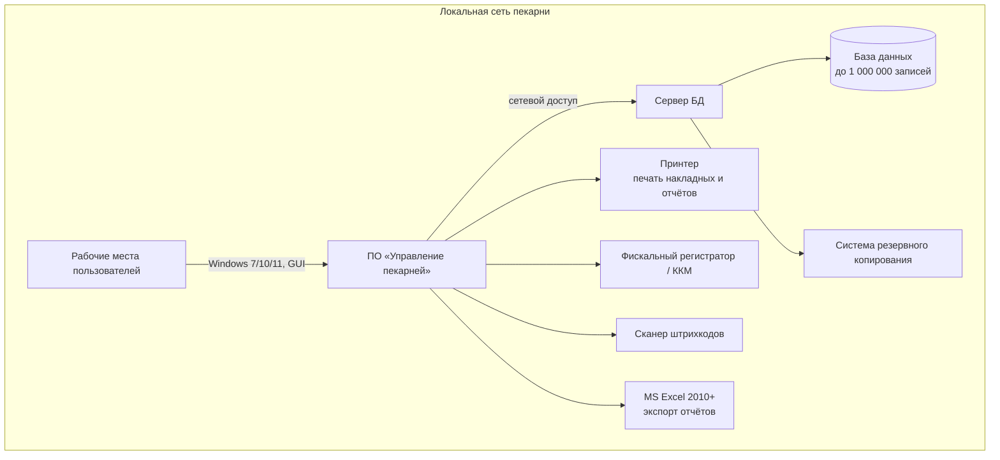

# UML-диаграммы — «Управление пекарней»

По ТЗ из readme.md репозитория. Диаграммы написаны на Mermaid (rendering в VSCode, GitHub, Mermaid Live Editor и т.п.).

---

## 1. Диаграмма вариантов использования (Use Case)

```mermaid
flowchart TD
    Tech[Технолог (кондитер)] --> UC1[Вести карточки изделий]
    Tech --> UC2[Вести справочник рецептур]
    Tech --> UC3[Оформлять заказы на изготовление]
    Tech --> UC4[Списывать сырьё в производство]

    Klad[Кладовщик] --> UC5[Вести справочник сырья и ингредиентов]
    Klad --> UC6[Учитывать приход сырья]
    Klad --> UC7[Проводить инвентаризацию]
    Klad --> UC8[Списывать просроченную продукцию]

    Kas[Кассир-продавец] --> UC9[Учитывать продажи через кассу]
    Kas --> UC10[Отпуск продукции по заказам]

    Adm[Администратор системы] --> UC11[Управление пользователями и правами]
    Adm --> UC12[Резервное копирование и восстановление БД]
    Adm --> UC13[Настройка цен и тарифов]

    Tech --> UC14[Формировать отчёт о выпуске продукции]
    Klad --> UC15[Формировать отчёт о расходе и остатках сырья]
    Kas --> UC16[Формировать отчёт о продажах и выручке]
    Adm --> UC17[Список позиций, требующих контроля]

    UC14 --> EX1[Экспорт в MS Excel]
    UC15 --> EX1
    UC16 --> EX1

    UC1 --> SEARCH[Поиск: наименование, категория]
    UC2 --> SEARCH
    UC5 --> SEARCH

    subgraph "Аутентификация"
        AUTH[Вход по паролю]
    end
    Tech --> AUTH
    Klad --> AUTH
    Kas --> AUTH
    Adm --> AUTH
```

---

## 2. Диаграмма классов (Class)



---

## 3. Диаграмма последовательности — списание сырья в производство (Sequence)



---

## 4. Диаграмма деятельности — оформление заказа на изготовление (Activity)



---

## 5. Диаграмма компонентов (Component)



---

## 6. Диаграмма развёртывания (Deployment)



---

### Замечания
- Диаграммы построены по тексту ТЗ и описывают **логику из документа**, без привязки к фактическому коду.
- Точные атрибуты сущностей (поля классов) уточняются по образцам документов из Приложений 1–3 ТЗ (карточка изделия, справочник рецептур, приходная накладная на сырьё).