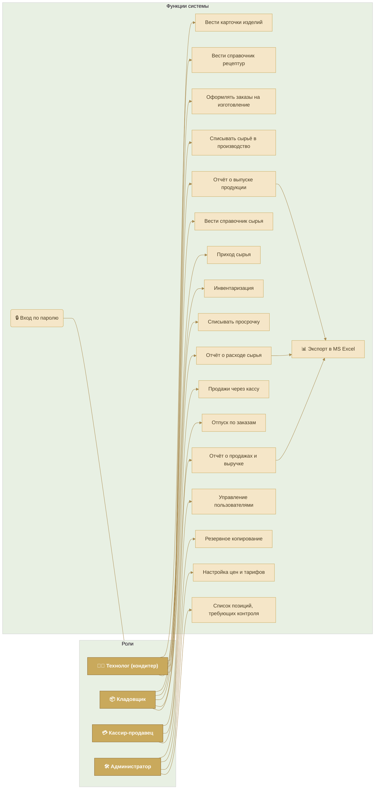
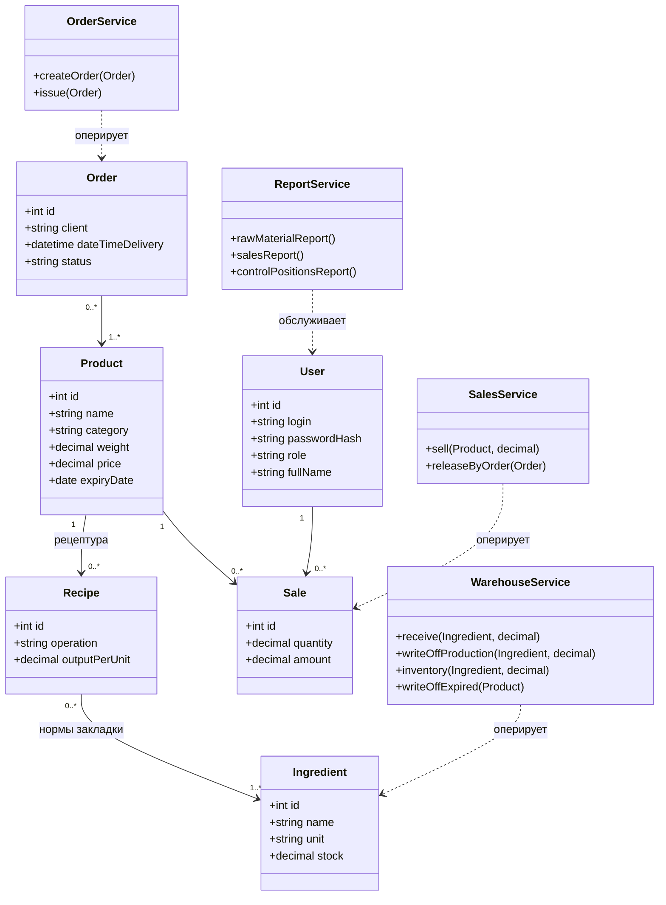
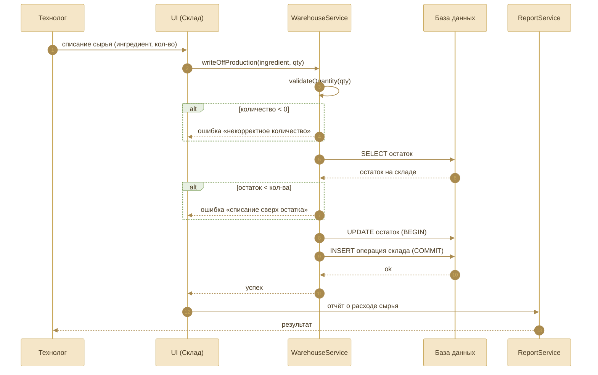
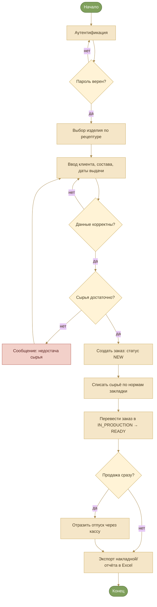
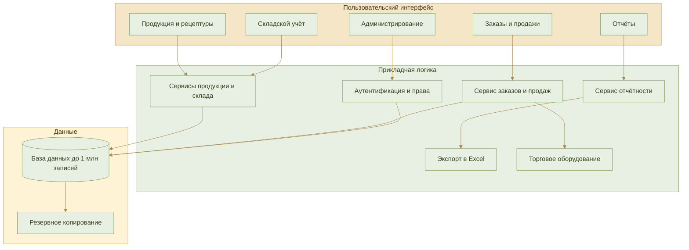
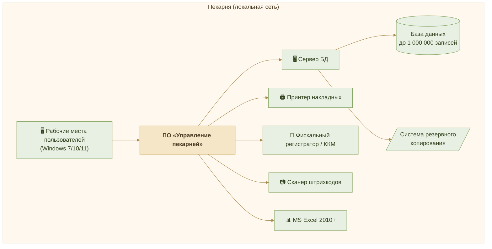

# UML-диаграммы — «Управление пекарней»

По ТЗ из readme.md. Все диаграммы объединены единой цветовой темой «Пекарня» (тёплые оттенки пшеницы и зелени). Код вставляется в любой Mermaid-редактор (VSCode, GitHub, Mermaid Live Editor).

---

## 1. Варианты использования (Use Case)

---

## 2. Классы (Class)

---

## 3. Последовательность — списание сырья в производство (Sequence)

---

## 4. Деятельность — оформление заказа на изготовление (Activity)

---

## 5. Компоненты (Component)

---

## 6. Развёртывание (Deployment)

---

### Замечания
- Это визуально другой стиль по сравнению с прошлым репозиторием: единая тема, `direction LR`, стилизация узлов и группировка по цвету. Набор типов диаграмм тот же.
- Диаграммы отражают логику ТЗ; точные атрибуты сущностей уточняются по образцам документов (карточка изделия, справочник рецептур, приходная накладная).